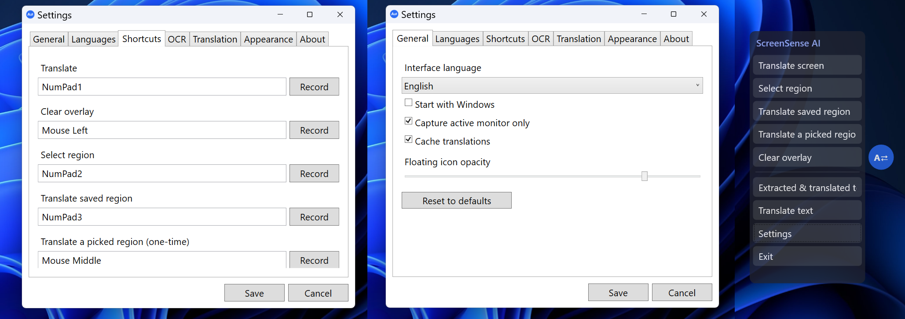
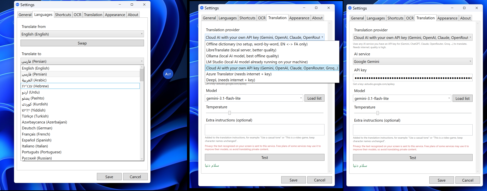
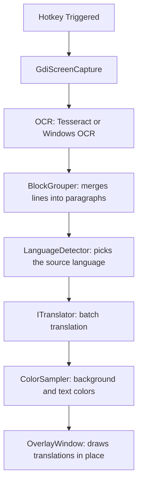

# 🔍 ScreenSense AI

**A desktop screen translator for Windows.**

Capture text on your screen, translate it, and overlay the translation directly on top of the original text.

---

### 📸 Preview

<p align="center">
  
  
</p>

### 🎥 Demo Videos

**Demo 1**

<video src="docs/v1.mp4" controls muted width="100%">
  <a href="docs/v1.mp4">Watch Demo Video 1 (v1.mp4)</a>
</video>

**Demo 2**

<video src="docs/v2.mp4" controls muted width="100%">
  <a href="docs/v2.mp4">Watch Demo Video 2 (v2.mp4)</a>
</video>

---

## ⚡ Key Features

* 📌 **Edge Panel & Quick Controls** — Floating icon at the screen edge with a roll-out control panel.
* 🎯 **Flexible Capture Modes** — Translate the entire screen, a saved region, or a region you pick each time, each with its own hotkey.
* ⌨️ **Advanced Hotkey System** — Bind hotkeys to keyboard keys, mouse buttons, or the mouse wheel via Settings.
* 🎨 **In-Place Overlay** — Draws the translation directly over the original text, with background and text colors sampled from the original.
* 🌐 **Bilingual Interface** — Full **English** and **Persian (فارسی)** UI.
* 🔠 **Extensive OCR Support** — OCR for about 100 languages, with language packs downloaded automatically.
* 🛠️ **Built-in Utilities** — A text viewer (extracted and translated text) and a manual text translation window.
* 🔌 **Flexible Engines** — Works out of the box with an offline dictionary; better providers (cloud and local LLMs) can be switched on in Settings.

---

## 📥 Download & Installation

1. Download the latest installer (`ScreenTranslator-Setup.exe`) from the [**Releases**](https://github.com/CodeCraftDevHQ/ScreenSenseAI/releases) page.
2. Run the setup wizard.

> [!NOTE]
> The installer is currently **not code-signed**. Windows SmartScreen may show a security warning on the first run. Click **"More info"** and then select **"Run anyway"**.

---

## 🌐 Translation Providers

No API keys ship with the app. Open Settings, choose a provider and enter your own details:

| Provider | Requirement | Notes / Features |
| :--- | :--- | :--- |
| **Offline Dictionary** | *None (Default)* | Offline word-by-word translation *(English & Persian only)*. |
| **LibreTranslate** | Server URL | Can run on your own machine. |
| **Ollama** | Ollama and a local model | Offline, editable prompt and temperature. |
| **LM Studio** | LM Studio with its local server started | Offline, editable prompt and temperature. |
| **Cloud AI** | Your own API key | **Google Gemini, OpenAI, Anthropic (Claude), OpenRouter, Groq, DeepSeek, Mistral**, or any OpenAI-compatible address. |
| **Azure Translator** | Key & Region | Free tier available. |
| **DeepL** | API Key | Keys ending in `:fx` use the free endpoint. |

> [!TIP]
> **Cloud AI:** All recognized text blocks are sent in a single request and a JSON array is expected back. If the reply cannot be parsed, it falls back to translating one block at a time.

---

## 🔒 Privacy & Security

* **Data Privacy:** When using Cloud AI, Azure, or DeepL, the text recognized on your screen is sent to that service. Free plans of some services may use submitted text to improve their models, so do not translate private content with them. **Ollama**, **LM Studio**, **LibreTranslate on your own machine**, and the **Offline Dictionary** keep everything on your computer.
* **Key Encryption:** API keys are stored in `%AppData%\ScreenTranslator\settings.json`, encrypted with **Windows DPAPI** for the current user. A settings file copied to another PC or user account cannot be decrypted, so keys must be entered again there.
* **In-Memory Capture:** Screenshots are processed in memory and are not saved.

---

## 🔄 How It Works



---

## 🛠️ Building & Development

### System Requirements
* **OS:** Windows 10 (Build 19041 or newer, 64-bit)
* **SDK:** .NET 10 SDK & Visual Studio 2026 (or any IDE with .NET 10 support)

### 1. Build and Run
```bash
dotnet restore
dotnet build -c Release
dotnet run
```

### 2. Publish Self-Contained Output
```bash
dotnet publish -c Release -r win-x64 --self-contained true -o publish
```

The result in `publish` is self-contained, so no separate .NET runtime install is needed on the target machine.

> [!IMPORTANT]
> **Single-File Output:** This app is intentionally **not** published as a single `.exe`. Tesseract's native DLLs fail to load reliably when bundled with `PublishSingleFile`. Keep the `publish` folder as it is.

### 3. Build the Installer (Inno Setup)
Install [Inno Setup](https://jrsoftware.org/isinfo.php), publish as above, then run:
```cmd
"C:\Program Files\Inno Setup 7\ISCC.exe" /DAppVersion=1.0.0 ScreenTranslator.iss
```
The installer is written to `dist\`.

---

## 📁 Project Layout

```text
docs/                    screenshots and demo videos used by this README
Models/                  settings and OCR data types
Native/                  Win32 interop
Localization/Loc.cs      English and Persian UI strings
Services/
  SettingsService.cs     JSON settings in %AppData%\ScreenTranslator, keys encrypted with DPAPI
  LanguageCatalog.cs     supported translation languages
  TranslationPipeline.cs capture to overlay orchestration
  ColorSampler.cs        background and foreground color per text block
  StartupRegistration.cs run at Windows startup
  Capture/               screen capture
  Ocr/                   Windows.Media.Ocr and Tesseract engines
  Text/                  line grouping and script based language detection
  Translation/           dictionary, LibreTranslate, Ollama, LM Studio, Cloud AI, Azure, DeepL, offline ONNX
  Input/                 low level keyboard and mouse hooks, hotkey manager
Views/
  FloatingIconWindow     edge icon with roll out panel
  OverlayWindow          click through topmost overlay
  RegionSelectWindow     drag to choose a capture region
  SettingsWindow         tabbed settings
  TextViewWindow         extracted and translated text
  ManualTranslateWindow  type text and translate it
```

---

## 🗺️ Roadmap / Remaining Work

- [ ] **Offline Engine:** `OfflineTranslator.TranslateAsync` needs the ONNX encoder/decoder and SentencePiece tokenizer.
- [ ] **Multi-Monitor DPI:** Mixed DPI multi-monitor setups need one overlay window per monitor.
- [ ] **Modern Capture API:** `Windows.Graphics.Capture` is a better capture backend than GDI for HDR and hardware accelerated surfaces.

---

## 📄 Licensing & Credits

This project is released under the [**Apache License 2.0**](LICENSE).

Third-party components are listed in `THIRD-PARTY-NOTICES.txt`; everything used here is MIT, Apache 2.0 or CC BY 4.0. No undocumented endpoints of commercial translation services are called.
